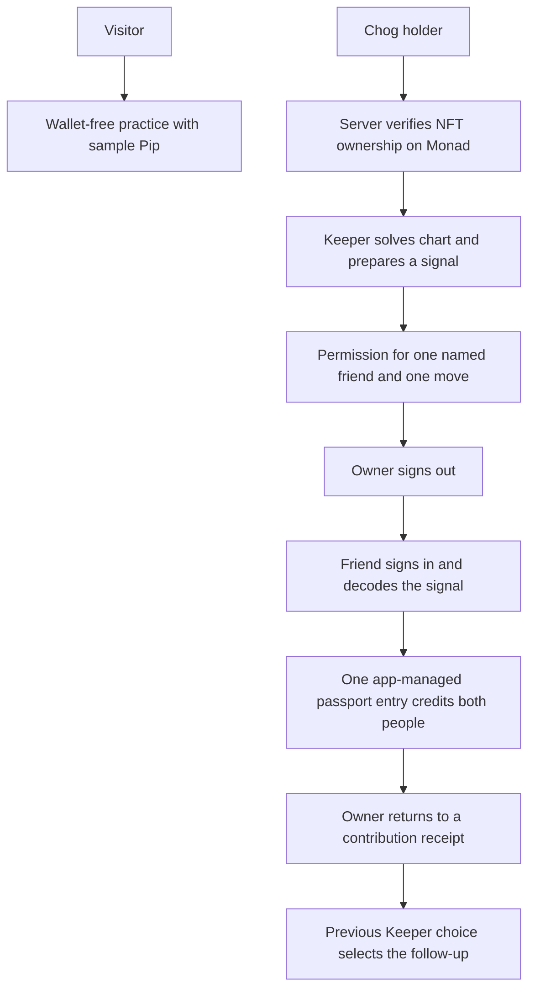
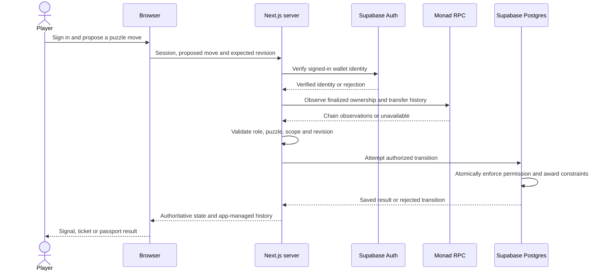

# About ChogHop

ChogHop is a cooperative puzzle adventure for the Chog NFT community on Monad. Set in a moonlit observatory, it lets an NFT owner and a friend solve a mystery together, even when they are not online at the same time.

The owner plays the **Keeper**, using chart clues to prepare a secret signal and inviting one friend to restore a lantern. The friend plays the **Runner**, decoding the signal through environmental examples. A scoped invitation gives that friend permission for one puzzle move without transferring the NFT or granting control of the owner's wallet. The friend does not need to own a Chog.

Each completed adventure adds a shared entry to the Chog's **expedition passport**, crediting both participants and returning a contribution receipt to the owner. The Keeper's recorded choice influences the next authored chapter, giving the Chog continuity across adventures. This passport is app-managed history stored in Supabase, not an onchain stamp.

ChogHop gives holders a way to bring friends into an activity built around their NFT. Anyone can first try **wallet-free practice** with an original sample character. The MVP contains two chapters: **The Last Lantern** and **The Returning Light**. Its fixture-based journeys are tested; genuine Monad holder and hosted Supabase end-to-end acceptance remain pending.

## How it works

1. Anyone can try wallet-free practice with Pip, an original sample character, and play both roles themselves.
2. In the holder relay, the owner signs in with their existing wallet. The server checks that wallet owns the selected Chog on the configured Monad collection.
3. As Keeper, the owner reads two surviving chart clues, deduces the missing symbol/direction and chooses Direct or Reflected. This makes the signal the friend will receive.
4. The owner names one friend's wallet and signs a separate permission for one run, one prepared signal and one correct lantern restoration. It expires after 30 minutes and can be revoked.
5. The friend signs in as Runner, reads two signal-to-lantern examples, infers the transformation and restores the lantern. The friend does not need to own a Chog. The owner's wallet need not remain connected.
6. Completion creates one app-managed passport entry for that NFT/run, crediting both people. The owner receives a contribution receipt from the same record.
7. The original Keeper can open The Returning Light. Its authored variation depends on the Chog's previous Keeper choice, so the next room remembers what happened.

The wallet login proves identity. The separate permission authorizes only an app action; it does not approve token spending, transfer the NFT or delegate arbitrary wallet transactions. The passport is stored by ChogHop in Supabase Postgres, not minted or written onchain. The first chapter and one follow-up are implemented; long-term retention and product-market fit remain unproven.




Practice is a separate simulation; it does not issue the holder ticket or award NFT history. The holder's NFT stays in their wallet throughout the relay.

## Play locally

For a wallet-free fixture preview of the full relay, run `node e2e/support/dev-preview.mjs` and open `http://127.0.0.1:3000/`. This starts Next dev, an in-memory PostgreSQL fixture and a local test-wallet bridge, overriding configuration only in child-process environments. It does not change `.env.local`. Ports 3000, 3001 and 54329 must be free. Records reset on restart; never deploy this test launcher.

Start practice at `/`, then Keeper at `/relay?fixture_role=keeper`. The page labels the acting test wallet and supplies sample Chog `801` and the correct guest address. Sign in, solve the Keeper chart, prepare the signal and sign one guest move. Click **Pass to test Runner · owner offline**: it signs the Keeper out, changes the fixture account and opens the invitation. Sign in as Runner, open the ticket and infer the lantern from both examples. No URL editing, extension or real wallet is needed. The offline owner is a simulation of this browser session ending; other browser profiles are independent. The invitation, Runner and earned passport share one route. Use **Return as test Keeper** to sign back in, resume the saved run, read the owner receipt and open the follow-up. Fixture actor switching clears local fixture auth/connection state. Each launcher start gets a new bridge identity, so stale fixture sessions are cleared after a restart while unrelated cookies are retained. Records reset when the launcher restarts.

```sh
npm ci --legacy-peer-deps
# Configure .env.local and apply the Supabase migration first; see supabase/README.md.
npm run dev
```

Open `http://127.0.0.1:3000`. No player wallet, sign-in or chain RPC is needed. The server needs Supabase configured as described in `supabase/README.md` and `.env.example`; missing storage returns a recoverable error rather than silently using memory. Inspect the scene, deduce the missing mark, choose a treatment and prepare the signal. The practice ticket lets you try the Runner role yourself. Decode the received signal using both environmental examples. A completed practice shows a sample passport page; it awards no live NFT history.

The illustration and sample character Pip are original layered SVG. Fredoka and Nunito Sans are bundled and self-hosted via Fontsource, with SIL Open Font License notices in `LICENSES/`. Practice uses no remote artwork. Configured live portraits use constrained collection metadata, never ownership authority. No audio is included. Reduced-motion preferences disable signal and stamp animations.

## Run the checks

Use Node **22.19.0** and npm **10.9.3**. Direct tool dependencies are pinned; transitive dependencies are locked in `package-lock.json`.

```sh
npm ci --legacy-peer-deps
npm test
npm run lint
npm run typecheck
npm run build
npx playwright install chromium
npm run test:e2e
```

If a managed network needs a custom CA, pass its trusted PEM through npm's `--cafile` option. Local certificate bundles and caches are ignored. Certificate verification stays enabled.

The default Playwright suite starts the production app on port 3000 and a loopback PostgreSQL test transport on port 54329. Close unrelated servers on those ports first. It requires no cloud credentials. The transport runs the exact migration and real PostgreSQL functions in PGlite; it is test-only, is not Supabase Auth/PostgREST, and is not a production fallback. The suite runs desktop/mobile Chromium, both treatments, invalid answers, refresh, keyboard controls, a 320px viewport, reduced motion, failed requests, expired sessions, lost successful responses, storage outages and API integrity checks. Screenshots and timing attachments go to ignored `test-results/`. If bundled Chromium cannot launch on a managed PC, `PLAYWRIGHT_CHANNEL=chrome` selects existing Chrome (PowerShell: `$env:PLAYWRIGHT_CHANNEL = 'chrome'`). To test the actual hosted Supabase integration, set `$env:CHOGHOP_E2E_STORAGE = 'supabase'` and rerun with `.env.local` configured; all acceptance records are tagged `test`.

## Practice storage and limitations

Practice state is server-owned in separate private Postgres tables, with an opaque HttpOnly, SameSite=Strict cookie scoped to `/api/practice`. Production cookies are Secure; only the session token's hash is stored. Two-hour expiry and 12-attempt/30-second limits use the database clock and persist across app workers. Browser actions contain a proposed move and expected revision; client completion flags cannot complete a run. Rejected moves leave puzzle state unchanged. Inspecting objects or changing controls makes no server attempt.

Refreshing restores the persisted stage, signal, handoff and completion; the application process holds no practice Map. Each accepted transition and its product event commit in one row-locked database transaction. Content/schema versions are recorded and checked. Unsupported or corrupt saved state fails closed; an outage does not replace a saved run. A reset closes the old run and retains its history. The sample ticket shows inviter, recipient role, character, allowed move and expiry; it issues no wallet permission. Practice has no live wallet, guest-permission or NFT passport records. See `supabase/README.md` for grants/RLS, event definitions, test limits, backup/export and hosted acceptance instructions. The local SQL checks do not establish that a real Supabase project has been configured or a cloud recovery drill has passed.

Automated chart-inspection timings are recorded under local test conditions against the 30-second interaction target. They are not evidence of independent human comprehension, fun, traction or product-market fit. Five independent puzzle playtests remain outstanding.

## Puzzle rules

The chart has three ordered slots and three glyphs: sun, moon, star. Every glyph appears once. The arrow advances one quarter clockwise per slot, including wraparound. Two visible marks uniquely determine the missing glyph and bearing.

The Keeper supplies that mark and chooses **direct** (fixed rotations) or **reflected** (fixed mirror axes). Glyphs use a three-position wheel; arrows use a four-position compass. The two wheels share the treatment but have separate offsets or axes. Preparation transforms the mark into a received signal.

The Runner sees that signal and two environmental **received signal → lantern** examples. The examples uniquely identify a decoding rule. The Runner supplies the inferred lantern glyph and bearing. None of the authored examples directly gives the target glyph or target bearing.

Six hand-authored configurations each support both treatments. The solver independently enumerates 12 possible chart answers and all 24 decoding rules from visible evidence. Tests require one unique chart answer, one decoding rule and one matching restoration for all 12 variant/treatment combinations. This proves solvability within the stated grammar; human playtesting is still needed to assess fun and clarity.

## Integration boundary

- `src/puzzle/engine.ts` proposes immutable transitions: Keeper → Runner → complete. Successful transitions increment revision and return an event. Incorrect actions return an error without advancing state or emitting an event.
- `keeperView` and `runnerView` project only their role's evidence. Keep full runs, authored variants and the solver on the server when real play is integrated. Never authorize a browser-supplied run or completion flag.
- The engine does **not** enforce participant identity, ownership, expiry, transactional concurrency or award uniqueness. The relay service and SQL gateway enforce identity, permissions, revisions, completion and passport uniqueness.
- No network access, randomness, clock, NFT metadata or collection address is used. These variants are authored puzzle content, not claims about real Chog traits.

The approved product plan remains at `C:\Users\PC\OneDrive\Documents\ChatGPT\chogathon 5\CHOGHOP_PLAN.md`.

## Live relay setup and limits

Open `/relay` after configuring the server. The default unconfigured screen labels the mock collection state and refuses live actions. Supply the variables in `.env.example`: rotated server-only Supabase service key, public publishable key, canonical app origin, Monad RPC/chain ID, actual collection address, ERC721 standard and deployment block. Enable Ethereum Web3 in Supabase Auth and allowlist the actual app URLs. Apply migrations 0001, 0002 and 0003 in order. No sample address is treated as a real collection. Existing EOA wallets and ERC-721 collections are currently supported; other standards fail closed.

Connect an injected wallet, sign the login message, enter your Chog token ID and verify ownership. Prepare the chart, name a different wallet, then sign the separate EIP-712 permission. It binds app origin/environment, chain/collection/token, expedition/run, signal hash/revision, ownership generation, nonce, allowed move, one-use budget and server-clock expiry. The collection anchors the signing domain; no custom contract, transaction or NFT approval is involved. Send the invitation link yourself. Its named guest signs in independently and solves the Runner stage while the owner is offline. Wrong deductions keep the move unused. Twelve attempts per thirty seconds are enforced across workers. Refresh restores the run and the owner's active invitation/revoke control.

PostgreSQL enforces one active permission and one successful guest contribution per NFT per expedition. Owners can revoke unused invitations or change the prepared signal, ending earlier permissions. Redemption atomically rechecks scope, expiry, revocation, revision and ownership generation, consumes the permission, saves both contributors, awards the passport and appends completion. Private tables have forced RLS and explicit grants. Browser roles cannot invoke the privileged RPC. Verified wallet identity comes from Auth `getUser()` identities, never editable user metadata. No raw signatures or credentials are stored in events.

A token's first use establishes a finalized ownership checkpoint before any permission can exist. Every later issuance/redemption scans all intervening ERC-721 transfers and checks historical `ownerOf` at that checkpoint. A monotonic generation invalidates away-and-back transfers. Each request scans at most eight provider-sized log windows and persists progress. Incomplete, unsupported, reorged or unavailable history fails closed. Default log span: ten blocks; raise it only to the configured provider's supported range. After long inactivity, repeat the selection/action to continue synchronization. Confirm archival/log access and finalized block tags against the real collection before advertising live permissions as transfer-safe. Checks observe finalized state, not pending transactions; Monad and PostgreSQL cannot form one atomic transaction, so a transfer after observation cannot be synchronously prevented. Previously valid completions remain recorded.

Portraits accept only exact operator-allowlisted public HTTPS hosts, 64 KiB JSON and 4 MiB raster images. Redirects, SVG, credentials, literal IPs, data/IPFS URLs and unsupported hosts are rejected. Missing portraits retain token identity. Allowlisted domains remain an operator trust boundary, including DNS rebinding; never allow arbitrary user domains. Portraits cannot authorize a move.

The isolated browser transport simulates Auth and Monad while running the actual SQL. It is never a production fallback or evidence of genuine Supabase Auth, production PostgREST concurrency or real holder acceptance. Relay fixture journeys are skipped in hosted mode; perform the genuine two-wallet acceptance manually after supplying configuration and migration 0003. Wallet/RPC outages preserve saved progress. The full analytics funnel and deployed holder acceptance remain pending.

Wallet pins: wagmi 3.7.8, viem 2.57.7, TanStack Query 5.104.5, Supabase JS 2.118.0 and SSR 0.12.7. The environment selects Monad mainnet or testnet; wallet network advertisements use viem's corresponding public network definition, while authoritative reads use only the server's configured RPC. Vite 8.3.4 is explicitly pinned for Vitest. Use the recorded `--legacy-peer-deps` install mode with the lockfile; type/runtime/browser checks verify this selected combination.

## Passport, receipt and remembered follow-up

After migrations 0001 and 0002, apply `supabase/migrations/202610210003_passport_and_followup.sql` once. It adds the passport, backfills previously saved qualifying completions using their original contributor/date fields, and extends the existing permission gateway without editing either applied migration. A database constraint enforces one entry per `(run, chain, collection, token)`. Passport insertion runs inside the completion transaction: if it fails, the move, permission consumption, completion and event roll back. Repeated award delivery is idempotent. The owner receipt is a projection of the same immutable entry, so it cannot award a second stamp.

The passport shows the actual owner and guest wallets, prepared treatment/signal, restored lantern/bearing, chapter and server completion time. It survives refresh and remains associated with the NFT after transfers. Original contributors retain their story; a newly verified current owner can use **Read Chog passport** to inspect its token history. Only the recorded Keeper receives the owner receipt. Records are app-managed, not onchain. Fixture records are labeled test data. Practice never contributes passport entries.

The original Keeper can open **The Returning Light** while still verified as owner. The database chooses authored variant `last-lantern-02` after a recorded direct choice and `last-lantern-03` after reflected. These are equivalent, solver-verified configurations with different visible charts. The remembered choice appears in the room. Browser-supplied choices/variant IDs cannot select the continuation. One continuation per first run is enforced by a unique parent-run constraint; refresh/repeated starts recover it. Its guest scope and contribution budget use a separate expedition identity, and it earns its own chapter stamp. No third chapter or unlimited retention claim is implied.

Live solo completion is deliberately unavailable: an owner cannot redeem their own invitation. Tests race an owner/solo attempt against the named guest and assert exactly one qualifying shared entry. No separate solo-completion feature was added. Replays, competing guest redemptions, duplicate awards, award failure rollback and upgrade/backfill are checked against the actual SQL. Full cloud recovery and genuine holder journeys remain release gates.


## Release preparation and acceptance

Migrations 0001, 0002 and 0003 are applied in the intended Supabase project, as confirmed by the operator on October 21, 2026. The latest polish release introduces no migration. The fixture launcher applies those same files to its isolated in-memory PostgreSQL database. This confirmation does not substitute for hosted end-to-end acceptance.

Practice is a simulated solo walkthrough with original sample art, separate cookies, tables and product events. It issues no wallet permission and earns no holder passport. Fixture relay uses public test wallets and simulated Auth/Monad responses with real application routes and SQL; all scenes and earned records are labeled. An unconfigured collection shows a mock label and cannot issue holder permissions. Metadata images may be unavailable; token identity remains visible. No production traction, live ownership success or human usability study is claimed.

For a real-holder rehearsal, stop the fixture launcher, configure the canonical application origin, Supabase Web3 authentication, actual collection/RPC/deployment block and server-only credentials as described above, then build and start the normal application. The owner connects an existing EOA holding a Chog and verifies its token ID. After preparing a signal, they enter the friend's actual wallet and sign the scoped permission. The friend opens the invitation on the canonical origin in their own browser/wallet, signs in, checks the named guest and expiry, and solves without the owner online. Return as owner to verify the receipt and remembered second chapter. Live Monad verification and this genuine two-wallet acceptance remain pending.

A permission ends after its one correct redemption, server-clock expiry, owner revocation, a changed signal/revision, or a detected ownership-generation change (including transfer away and back). An incorrect answer does not consume the move. Expired/revoked tickets remain readable and direct the guest to request a fresh invitation. A declined signature authorizes nothing. Network failures preserve selected answers and saved runs; retry the action or reload the saved run if the response was lost. Server checks remain authoritative even if browser clocks or displayed states differ.

Holder passports, immutable contributor records, receipts, runs and events live in private Supabase Postgres tables with RLS and server-only grants. A receipt projects the same shared entry, and the DB prevents duplicate awards. A passport is app-managed NFT history, not an onchain stamp, transferable asset or token reward. The two authored chapters are the complete content set; no third chapter, audio, hint ladder or contribution replay has been added. CSS motion honors reduced motion; all information is available without animation or sound. Production deployment and authentic holder verification are separate release gates.


## Audits and Verification


These are internal engineering checks, not an independent third-party security audit. The last completed application verification passed **87 unit/database tests and 28 desktop/mobile browser checks**, plus separate fixture-preview checks at **1440px and 320px**. Lint, typecheck and the production build passed. These counts describe the recorded verification run, not a claim that tests were rerun for every documentation edit.

| Area | What was tested |
|---|---|
| Puzzle engine | Valid/invalid answers, both treatments, authored variants, unique solutions and solver-proven solvability |
| Permissions | Wrong guest, expired/revoked tickets, stale signal/run revisions, replay prevention and transfer away-and-back invalidation |
| Atomic completion | Competing redemptions, owner/solo versus guest races, duplicate awards and exactly one passport entry per NFT/run |
| Persistence | Refresh/resume, lost successful responses, storage outages, contribution receipts and remembered follow-up selection |
| Recovery UI | Loading, empty passport, rejected signature, network failure, readable expired/revoked tickets and blocked invalid actions |
| Accessibility/mobile | 320px layout, keyboard radio controls, focus states, reduced motion, no horizontal clipping and inspected mobile screenshots |
| Fixture handoff | Keeper logout, switch to the named test Runner, explicit simulated offline owner, stale-session cleanup and unrelated-cookie preservation |
| Build quality | Unit/database suite, browser suite, lint, TypeScript checks and optimized production build |

The production desktop/mobile suite covers both practice treatments, refreshed runs, the owner-offline relay and follow-up, empty passports, loading feedback, rejected signatures, network failures, and expired/revoked tickets. Presentation-only ended-ticket cases use explicit response fixtures; permission enforcement and award races are tested separately against the real SQL. The mobile action tray stays in document flow so it cannot cover the clue controls. Browser screenshots are written to ignored `test-results/`.

With the fixture preview running, `node e2e/support/check-preview.mjs` separately checks the actual one-button Keeper logout and Runner switch at 1440px and 320px, keyboard focus, reduced motion, stale-session cleanup and preservation of unrelated cookies. This script requires installed Chrome and uses only disposable local fixture records. Stop the preview before `npm run test:e2e`, which owns ports 3000 and 54329. The checked body, muted, ticket, action and success foreground/background pairs exceed 4.5:1 contrast; this is not a claim of a formal accessibility audit.


Verified October 21, 2026: **87 unit/database tests**, **28 production desktop/mobile browser checks**, lint, typecheck and production build passed. The separate preview check passed at **1440px and 320px**, including stale fixture session cleanup, unrelated-cookie preservation, keyboard focus, owner logout, Runner handoff, passport award, reduced motion and no horizontal clipping. Mobile screenshots were inspected. All chain/Auth responses in these runs were fixtures; genuine Monad holder and hosted Supabase end-to-end acceptance remain pending. Migration 0003 being applied is operator-confirmed, not an independently observed hosted acceptance result.


## Benefits and intended users

| User | What they gain | What is still a hypothesis |
|---|---|---|
| Chog holders | A reason to use a Chog in a shared activity and a record of their contribution | Whether they voluntarily return after the two chapters |
| Friends, including non-holders | A limited invitation into the experience without buying or borrowing the NFT | Whether invitations produce enjoyable community introductions |
| New visitors and judges | A playable practice before wallet setup | Whether first-time players understand the deduction without coaching |
| Community organizers | A candidate format for small cooperative events and future chapter releases | Demand, distribution support and willingness to pay |

The current product offers short cooperative play, asynchronous participation, limited permissions and remembered history. It does not promise investment returns, rewards, token demand, NFT price appreciation, proven growth or proven recurring usage. An organizer dashboard, paid chapters and broader community campaigns are not implemented.

## Judging: what we can demonstrate honestly

| Criterion supplied by the entrant | Our strongest evidence | Limitation to say out loud |
|---|---|---|
| Novelty | A holder prepares an NFT-associated puzzle, delegates one move to a named non-holder and receives shared history that affects the next room | Do not claim this is the world's first NFT co-op game or a new onchain delegation standard |
| Fun | Real chart deduction, a second decoding role, an original observatory and a lantern/stamp payoff | Automated solvability is not proof of fun; observe independent players |
| Retention | Owner receipt, two credited contributions and a second chapter chosen from the first Keeper choice | This is a return mechanism, not measured retention; only two chapters exist |
| Clarity | Practice first, chart/lantern role icons, explicit tickets, visible mode labels and fixture handoff button | Real wallet and signature onboarding still needs genuine-holder usability testing |
| Execution | Prior passing verification: 87 unit/database tests, 28 desktop/mobile checks, 320px fixture handoff, lint/typecheck/build; server-side validation and DB award constraints | These were isolated fixtures; live Monad, hosted Auth and deployment acceptance remain pending |
| $CHOG and NFT relevance | The real Chog NFT is required to start a holder relay, controls authorization and anchors its passport/continuation | No fungible $CHOG integration: no balance check, payment, staking, burn or reward. Practice needs neither asset |

The puzzle could technically exist without NFTs. The NFT is essential to the implemented holder authorization/history model, not mathematically necessary to the puzzle. No NFT trait currently changes the puzzle; the previous Keeper choice selects the follow-up. Present this as meaningful but bounded NFT utility. Do not claim the app permission is enforced by a custom contract.

These rows assess the six criteria provided by the entrant; they are not independent confirmation of the organizer's current rubric. Confirm whether $CHOG use is mandatory, optional, or a separate bonus before submitting. If mandatory, the current MVP does not meet that particular requirement. Do not quietly add token payouts or approvals just to imply compliance.

## Where the project goes next

Before the deadline, prioritize genuine-holder verification, a stable deployed URL, several uncoached playtests and a clear three-minute demo. Fix any blocker they uncover before adding features. The agreed working deadline is October 23, 13:00 Africa/Lagos; reconfirm the organizer's deadline and submission fields.

After the hackathon, let evidence decide: if players cannot explain the puzzle, improve onboarding; if invited friends drop out, simplify the invitation and wallet flow; if people finish both rooms and request more, author a small new chapter pack and measure voluntary returns. After the core release gate passes, the previously planned contribution replay and hint ladder can be evaluated. Neither is currently shipped. An organizer pilot could test recurring community adventures and possible paid content later; do not present an untested business model as product-market fit. Oracle, Dynamic, custom contracts and token payouts remain outside the approved MVP.

## Simple testing instructions

For a nontechnical walkthrough, use the fixture preview. It needs no real wallet, NFT, cloud credentials or token purchase:

```powershell
Set-Location 'C:\Users\PC\Projects\ChogHop'
# First setup only, using the pinned Node/npm versions:
npm ci --legacy-peer-deps
node e2e/support/dev-preview.mjs
```

Keep that terminal running. Open `http://127.0.0.1:3000/` in Chrome. Use exactly 127.0.0.1, not a different hostname, for fixture sign-in. Finish practice first. Then open `/relay?fixture_role=keeper`, sign in with the supplied test wallet, verify sample Chog 801, solve the chart, prepare a signal and sign the guest permission. Click **Pass to test Runner · owner offline**, sign in as Runner, open the ticket and solve from the examples. The passport should credit both people exactly once. Use **Return as test Keeper**, sign in, resume the run and inspect the receipt. Open The Returning Light and repeat the handoff. Refresh after completion: there should be one entry for each completed chapter, not another stamp for the same run. On a fresh fixture database, the quick-reference answers are Star/South for chapter one, then Moon/East after Direct or Moon/West after Reflected for chapter two. Use those only for operator checks; do not coach a usability test.

Restarting the launcher resets its disposable database and clears stale fixture sessions. This is different from real hosted persistence. For negative checks, try an incorrect answer (permission stays unused), decline a signature (no permission issued), revoke an unused ticket as owner (guest cannot solve), allow a fresh ticket to expire (no restoration action), and briefly go offline after the page loads (a recoverable message should preserve the selected answer). Test keyboard Tab/arrows/Enter, 320px width and the browser/OS reduced-motion preference. The automated suite covers integrity cases that should not be tested by moving valuable NFTs.

For automated verification, stop the preview first, then run the commands under "Run the checks". The default browser suite starts its own isolated services. To exercise the special preview handoff, start the preview and run `node e2e/support/check-preview.mjs` in another terminal. These checks are not proof of a live-chain integration.

## Under the hood: technology stack

| Layer | Pinned implementation | Job |
|---|---|---|
| App and UI | Next.js App Router 16.4.2, React 19.3.1, TypeScript 5.9.3 | Pages, server endpoints and typed puzzle/game logic |
| Styling/art | Tailwind CSS 4.3.3, original layered SVG/CSS, self-hosted Fredoka/Nunito Sans | The observatory, paper tickets, readable clues and stamp reveal |
| Wallet | wagmi 3.7.8 and viem 2.57.7 | Wallet connection, message signatures and server RPC reads |
| Browser data | TanStack Query 5.104.5 | Query provider supporting wallet integration |
| Identity/storage | Supabase JS 2.118.0, SSR 0.12.7; Auth Web3 and Postgres with RLS/explicit grants | Prove who signed in and store authoritative runs, permissions, events and passport history |
| Chain | Monad; mainnet chain 143, optional explicitly configured testnet 10143 | Verify the existing collection's ERC-721 ownership and intervening transfers |
| Verification | Vitest 5.0.5, Playwright 1.64.1, PGlite 0.5.10 for local SQL fixtures | Check deduction, invalid moves, races, browser flows and responsive behavior |
| Delivery | Vercel target; local Node 22.19.0/npm 10.9.3 | Build and host the web app/API; live deployment still pending |



This diagram describes the holder flow. Practice uses separate server/database records and does not require wallet or chain verification. No passport write goes to Monad. Not every read-only request scans the chain; required ownership-sensitive actions use the collection adapter.

Browser proposes a move -> Next server verifies identity/ownership/scope and puzzle -> Postgres atomically saves a valid transition and any passport award -> browser receives the result. A browser completion flag is never enough. Metadata artwork cannot prove ownership. Monad checks use finalized chain observations; the blockchain and Postgres cannot form a single atomic transaction, so there is a disclosed observation-to-commit transfer window. No LLM call, oracle, custom contract, token payout, Dynamic integration or custom WebSocket server is part of this stack.

## Step-by-step deployment and real-holder acceptance

Use one stable HTTPS hostname for the canonical app origin; permissions and sign-in are domain-bound. Choose it before issuing demo invitations. A renamed domain or different environment requires fresh invitations.

1. Arrange an owner who genuinely holds an NFT from the configured Chog Genesis collection on Monad mainnet and a friend using a different EOA wallet. Neither person shares wallet secrets. The friend need not hold a Chog. Use a separate browser profile/device for each. Do not use the supplied fixture keys for genuine acceptance.
2. Confirm the intended Supabase project. Migrations 0001, 0002 and 0003 are already operator-confirmed applied there; do not reapply them to a populated project. A new project must receive the three migration files in order. Enable Ethereum Web3 under Auth Providers/Web3. Set the intended HTTPS Site URL and allowed application/redirect URLs for this project. Retain RLS and the private schema/grants from the migrations.
3. Prepare valid runtime settings using `.env.example` as the field list, without publishing any local secret file. The previously pasted service-role credential must be rotated before release; update the private hosting secret directly and never paste it into an issue or video. Confirm the current collection address and deployment block through trusted collection/chain evidence, rather than substituting a sample address.
4. Before the full rehearsal, verify that the RPC supports mainnet chain 143, ERC-721 interface checks, finalized blocks, historical `ownerOf`, checkpoint block hashes and token-filtered Transfer logs. The first use establishes a finalized ownership baseline; later grants/redemptions scan intervening history. Match `CHOG_LOG_BLOCK_SPAN` to the provider's actual supported log range. Long idle gaps can need repeated synchronization requests; persistent synchronization errors are a release blocker, not a successful ownership check. A transfer-away-and-back check should use an agreed test asset on a controlled environment, not an unsolicited transfer of a valuable holder NFT.
5. Push the reviewed commit to the repository you intend to deploy, keeping `.env.local`, service keys and local artifacts out of Git. On Vercel, choose Add New/New Project and import that repository. Select the ChogHop repository root and Next.js preset. Use install command `npm ci --legacy-peer-deps` and build command `npm run build`; let Vercel manage the Next.js output. Select Node 22.x. Local exact Node/npm pins remain the reproducible local setup; Vercel manages supported runtime patch versions, so verify its actual build output instead of claiming an exact hosted patch.
6. Add the environment variables below to the intended Vercel environment, then deploy/redeploy. Production and Preview settings are separate. Do not run or deploy `dev-preview.mjs`; do not set `CHOGHOP_FIXTURE_PREVIEW`, use loopback fixture RPC/Auth URLs, or upload test private keys. Public code is deployed; private service/RPC credentials belong only in server settings. `NEXT_PUBLIC_SUPABASE_PUBLISHABLE_KEY` is the public key, never the service-role key. A `DATABASE_URL` is not required by the app runtime when migrations are applied using the SQL editor.
7. Use a private rehearsal deployment or limited release initially. If its hostname differs from the final public hostname, configure the corresponding origin/Auth allowlist and issue fresh invitations there. Keep preview and production records/projects separate where practical; changing `CHOGHOP_ENVIRONMENT` also changes permission scope. Verify the chosen public submission deployment is reachable by judges in a fresh signed-out/incognito browser. Do not change unrelated project security settings just to make a preview link work; choose the intended public production deployment and its appropriate access policy.
8. On the stable deployed URL, test practice without a wallet, then have the actual owner connect/sign in, select their actual token ID, and prepare the chart. The input is the NFT's token number, not a wallet or collection address. Have the owner invite the friend's exact wallet, inspect/sign the scoped permission, save the Keeper URL and send the invitation themselves.
9. Have the owner sign out and close their tab. The friend independently opens the same HTTPS-origin invitation, signs in on the configured network, checks the named guest, token, allowed move and expiry, then decodes and solves. This rehearsal must use real wallets and live RPC/Supabase, with no fixture bridge. Wrong guesses must leave the move unused.
10. Verify redeemed status, exactly one passport entry and both contributor addresses. Refresh it. Reopen the saved Keeper URL as the owner and verify the receipt. Open the remembered follow-up and verify its selected variant. Separately exercise an unused revoked invitation and an expired invitation; replay should not award again. Review app errors and private database rows as the authorized operator without publishing logs containing credentials or private identifiers.
11. Record the commit/deployment URL, date/time/timezone, chain ID, collection, consenting participant identifiers, token ID, test results and any limitations in a private acceptance sheet. Mark live integration verified only after these observations; hosted practice tests alone do not establish real-holder success. Test once more at the final public hostname after any domain/env change.

| Vercel variable | Value/source |
|---|---|
| `SUPABASE_URL` | Intended hosted Supabase project's HTTPS URL |
| `SUPABASE_SERVICE_ROLE_KEY` | Rotated server-only project credential |
| `NEXT_PUBLIC_SUPABASE_PUBLISHABLE_KEY` | Public key from the same project |
| `CHOGHOP_ENVIRONMENT` | `production` for final release; use a separate, clearly tracked rehearsal environment |
| `CHOGHOP_APP_ORIGIN` | Exact stable public HTTPS origin, no trailing slash |
| `MONAD_CHAIN_ID` | `143` for genuine mainnet acceptance |
| `MONAD_RPC_URL` | Working mainnet HTTPS RPC with the required historical/log support |
| `CHOG_COLLECTION_ADDRESS` | Verified real collection address; never the fixture address |
| `CHOG_COLLECTION_STANDARD` | `ERC721` |
| `CHOG_DEPLOYMENT_BLOCK` | Verified deployment block, as a decimal integer |
| `CHOG_LOG_BLOCK_SPAN` | A range supported by that provider; current default is 10 |
| `CHOG_MEDIA_HOSTS` | Only exact trusted HTTPS metadata/image hosts, or empty to disable remote portraits |

For an optional local real-service rehearsal, use the normal `npm run dev`, not the fixture launcher, with privately configured real services and allowed local origin. A friend's separate device cannot reach your PC using its own 127.0.0.1 URL; use the shared HTTPS deployment for the final two-person test. This documentation update does not change `.env.local` or perform deployment.


## Operational references

Official operational references: [Supabase Web3 sign-in](https://supabase.com/docs/guides/auth/auth-web3), [Supabase allowed redirect URLs](https://supabase.com/docs/guides/auth/redirect-urls), [Vercel Git deployment](https://vercel.com/docs/git), [Vercel environment variables](https://vercel.com/docs/environment-variables), [Vercel environments](https://vercel.com/docs/deployments/environments), [Vercel Node versions](https://vercel.com/docs/functions/runtimes/node-js/node-js-versions), and [Vercel deployment protection](https://vercel.com/docs/deployment-protection). Product behavior and dependency versions above were checked against this repository; no new live acceptance result is claimed.

## License

ChogHop's original project code and documentation are licensed under the [MIT License](LICENSE), copyright 2026 ChogHop contributors. You may use, modify and redistribute the software subject to that license's notice requirements.

Bundled fonts and dependencies retain their own licenses. Font notices are preserved in [LICENSES/Fredoka.txt](LICENSES/Fredoka.txt) and [LICENSES/NunitoSans.txt](LICENSES/NunitoSans.txt). This software license does not grant rights to third-party Chog branding, collection artwork or externally fetched NFT images.
